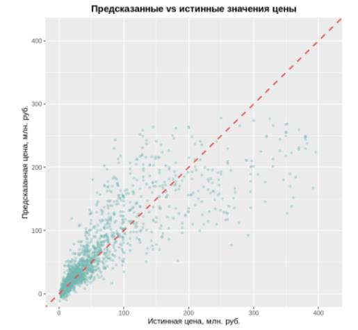
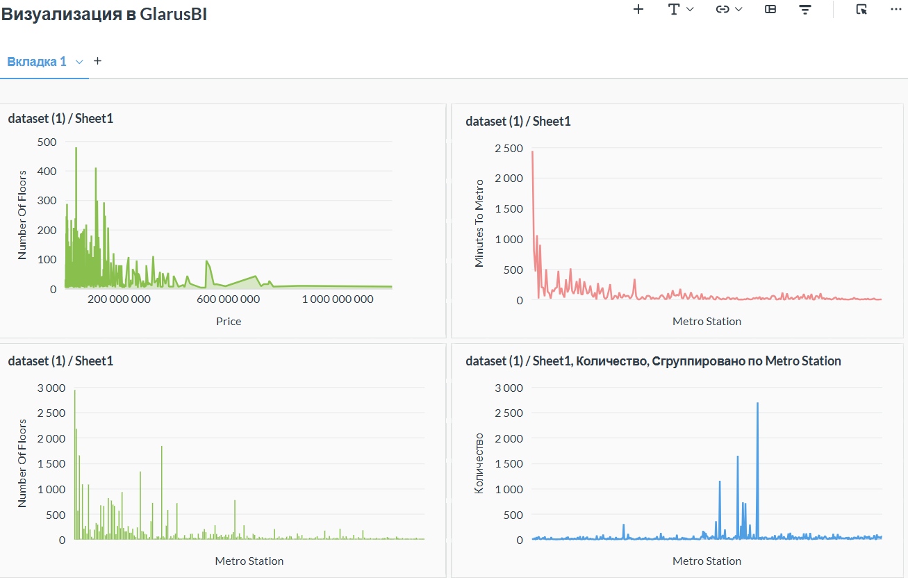
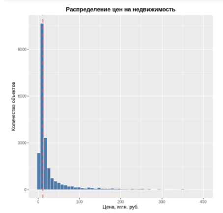
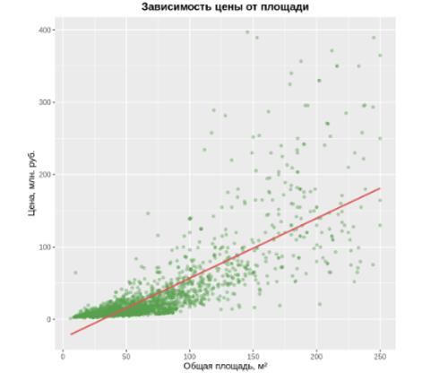
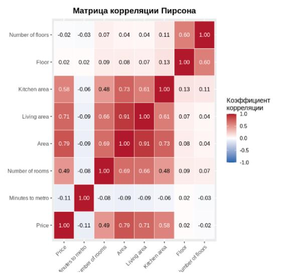
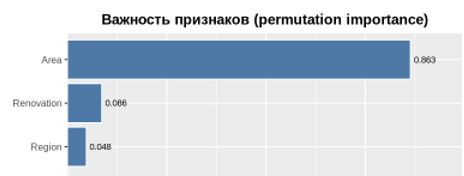

# Прогноз цен на квартиры в Москве с помощью нейронной сети (R)

Курсовой проект: регрессионная модель на основе полносвязной нейронной сети,
которая оценивает рыночную стоимость квартир в Москве и Московской области.
Разведочный анализ и модель сделаны на R, интерактивные отчёты — в Glarus BI.

## Результат

| Метрика (тестовая выборка, 20%) | Значение |
| --- | --- |
| R² | **0,778** |
| MAE | 9,92 млн руб. |
| RMSE | 24,56 млн руб. |
| MAPE | 31,5 % |

Сильнее всего на прогноз влияют **площадь** (86 % суммарной важности),
**тип ремонта** (9 %) и **район** (5 %) — по методу перестановочной важности.



## Данные

[Moscow Housing Price Dataset](https://www.kaggle.com/datasets/egorkainov/moscow-housing-price-dataset) (Kaggle):
22 676 объявлений, 12 признаков — цена, площадь (общая, жилая, кухни), число комнат,
этаж и этажность, тип жилья, тип ремонта, регион, станция и время до метро.
Пропусков в данных нет. Как скачать — в [data/README.md](data/README.md).

## Что сделано

1. **Проверка данных** — пропуски, типы, приведение категорий к factor.
2. **Разведочный анализ** — распределение цены (сильная правосторонняя асимметрия:
   среднее 36,1 млн руб. при медиане 11,3 млн руб.), площадь по типам жилья,
   зависимость цены от площади, распределение по типу ремонта.
3. **Корреляционный анализ** — матрица Пирсона и проверка значимости при α = 0,05.
   Сильнее всего с ценой связана площадь (r ≈ 0,79); Area и Living area
   мультиколлинеарны (r ≈ 0,93).
4. **Подготовка к обучению** — удаление выбросов выше 99-го перцентиля цены,
   one-hot-кодирование категорий, разбиение 80/20, Min-Max-нормализация
   (параметры считаются только по обучающей выборке).
5. **Модель** — полносвязная сеть `neuralnet` с двумя скрытыми слоями (64 и 32 нейрона)
   и линейным выходом.
6. **Оценка и интерпретация** — MAE, RMSE, MAPE, R², график «прогноз vs факт»,
   распределение остатков, permutation importance.
7. **Отчётность** — интерактивные дашборды в Glarus BI.



| | |
| --- | --- |
|  |  |
|  |  |

## Выводы и ограничения

- Модель объясняет около 78 % дисперсии цены. Средняя ошибка в процентах (MAPE 31,5 %)
  велика: модель хорошо ловит общий уровень цены, но заметно ошибается на дорогих
  объектах, которых в выборке мало (см. разброс в верхней части графика).
- Площадь доминирует в прогнозе; признаки этажа и времени до метро почти не влияют.
- Что можно улучшить: прогнозировать логарифм цены (из-за асимметрии распределения),
  сравнить сеть с градиентным бустингом (CatBoost, LightGBM), добавить признаки
  расположения (расстояние до центра по станции метро).

## Запуск

```bash
# 1. Положите датасет в data/data.csv
# 2. Запустите все шаги (пакеты установятся автоматически)
Rscript run_all.R
```

Отдельные шаги лежат в папке `R/` и пронумерованы по порядку; графики сохраняются в `figures/`.

## Стек

R · dplyr · ggplot2 · caret · neuralnet · reshape2 · Glarus BI
